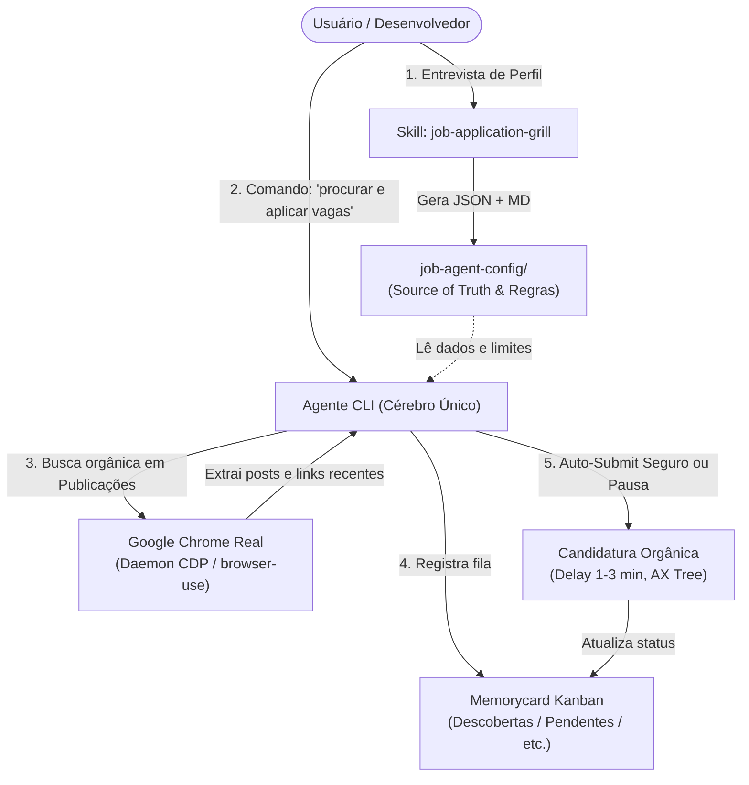

# 🎯 Job Apply Agent

> **Agente de Descoberta e Candidatura Orgânica a Vagas com IA**  
> Desenvolvido com base em `browser-use`, orquestrado via arquitetura de **Cérebro Único no CLI** e integrado a um navegador Google Chrome real via CDP com persistência de sessão e proteção anti-bot.

---

## 🌟 Visão Geral

Ao contrário de robôs tradicionais de disparo em massa que causam *shadowban*, reprovações imediatas por divergência de dados ou bloqueios por anti-bot, o **Job Apply Agent** opera como um assistente de alta conversão:

- 🧠 **Cérebro Único no CLI (`RULE-002`)**: Não depende de múltiplos scripts com chaves de API pagas ou servidores locais pesados. O Agente CLI comanda a triagem, avalia semântica e coordena a navegação.
- 🕶️ **Navegação Orgânica & Furtiva (`ADR-001`, `ADR-003`)**: Conecta-se diretamente ao Google Chrome real do usuário (já autenticado), reutilizando cookies e histórico de navegação via daemon CDP contínuo.
- 🛡️ **Zero Alucinação & Blindagem de ATS**: Utiliza uma base imutável (*Source of Truth*) para responder perguntas eliminatórias (*Knockout Questions*), garantindo que datas, anos de experiência e competências batam 100% com o seu perfil público do LinkedIn.
- 📋 **Gestão de Pipeline no Kanban (`Memorycard`)**: Cada vaga descoberta entra em um fluxo estruturado (*Descobertas*, *Em Andamento*, *Aplicadas*, *Aguardando Retorno*, *Pendentes*, *Expiradas*).
- 🤝 **Supervisão Humana Mandatória (`RULE-001`)**: Se deparar com verificações de SMS/2FA, CAPTCHA ou formulários com dúvidas conceituais, o agente nunca chuta: ele move a vaga para a coluna *Pendentes* e notifica o usuário.

---

## 🏗️ Arquitetura



---

## 🚀 Como Começar

### 1. Pré-requisitos
- Python 3.11 ou superior
- Google Chrome instalado
- Git

### 2. Clonar o Repositório e Instalar Dependências
```bash
git clone https://github.com/SEU-USUARIO/job-apply.git
cd job-apply

# Criar ambiente virtual
python -m venv .venv

# Ativar ambiente virtual
# No Windows:
.venv\Scripts\activate
# No Linux/macOS:
source .venv/bin/activate

# Instalar dependências
pip install -r requirements.txt
playwright install chromium
```

### 3. Configurar Variáveis de Ambiente
Copie o arquivo de exemplo e configure conforme necessário:
```bash
cp .env.example .env
```

---

## ⚙️ Configuração do Seu Perfil

O agente precisa conhecer o seu perfil, preferências e respostas para perguntas eliminatórias antes de aplicar para vagas. Você pode configurar isso de duas maneiras:

### Opção A: Via Entrevista com IA (Recomendado)
Se você estiver utilizando um ambiente com suporte a agentes de codificação (como o **Antigravity CLI**), basta solicitar no chat:
> *"Inicie a entrevista com a skill `job-application-grill`."*

O agente fará uma entrevista consultiva em 4 etapas:
1. **Fase 1**: Funil de vagas, senioridade, cargos e pisos salariais.
2. **Fase 2**: Blindagem de *Knockout Questions*, autorização legal e matriz de anos de experiência.
3. **Fase 3**: Extração do histórico profissional (*Source of Truth*) alinhado ao LinkedIn.
4. **Fase 4**: Definição de taxas de envio diário, delays e nível de autonomia.

### Opção B: Preenchimento Manual
Copie os modelos da pasta [`job-agent-config/examples/`](job-agent-config/examples/) para a raiz de [`job-agent-config/`](job-agent-config/) e personalize seus dados:
- `01-funnel-preferences.json` / `.md`
- `02-knockout-rules.json` / `.md`
- `03-profile-source-of-truth.json` / `.md`
- `04-autonomy-and-operation.json` / `04-autonomia-e-operacao.md`

> 🔒 **Privacidade**: Arquivos de perfil preenchidos em `job-agent-config/` e currículos em PDF em `assets/resumes/` estão no `.gitignore` e **nunca** serão versionados publicamente no seu repositório.

---

## 📄 Adicionar seus Currículos

Coloque seu currículo base em formato PDF na pasta [`assets/resumes/`](assets/resumes/):
- `curriculo_principal.pdf` (padrão utilizado pelo robô)
- *(Opcional)* `curriculo_en.pdf` (versão em inglês para vagas internacionais)

---

## 📊 Pipeline de Vagas no Kanban (`.memorycard`)

As oportunidades mapeadas são rastreadas pelo Kanban local:

| Coluna | Descrição |
| :--- | :--- |
| **Descobertas** | Vagas coletadas nas últimas 24-72h que passaram pelo filtro de corte (> 75% match). |
| **Em Andamento** | Vaga atualmente em processamento pelo robô ou tarefa de desenvolvimento. |
| **Aplicadas** | Candidaturas submetidas com sucesso com data e confirmação. |
| **Aguardando Retorno** | Candidaturas ativas aguardando contato do recrutador. |
| **Pendentes** | Vagas que exigiram intervenção humana (2FA, CAPTCHA, envio por e-mail ou pergunta desconhecida). |
| **Expiradas** | Oportunidades pendentes ou aplicadas cujo prazo de validade expirou. |
| **Concluídas** | Tarefas gerais e fluxos finalizados. |

---

## 📚 Documentação Técnica

- **[Documentação Geral (`docs/index.md`)](docs/index.md)**: Sumário de regras e governança do projeto.
- **[Decisões de Arquitetura (`docs/adr/`)](docs/adr/browser-connection.md)**: Registros formais sobre a conexão via CDP e árvore de acessibilidade.
- **[Regras Operacionais (`docs/rules/`)](docs/rules/operational-rules.md)**: Diretrizes de execução, limites e segurança *Human-in-the-Loop*.
- **[Especificação Completa (`spec.md`)](spec.md)**: Riscos de anti-bot, ATS e estratégias de mitigação.

---

## ⚖️ Boas Práticas e Segurança Anti-Ban

1. **Volume Seguro**: Mantenha no máximo de 10 a 25 candidaturas por dia no LinkedIn.
2. **Delays Orgânicos**: Utilize pausas randômicas de 1 a 3 minutos entre submissões consecutivas.
3. **Respeito aos Termos**: O uso de automação deve ser responsável e respeitar os limites operacionais das plataformas.

---

## 📄 Licença

Distribuído sob a licença MIT. Consulte `LICENSE` para mais informações.
